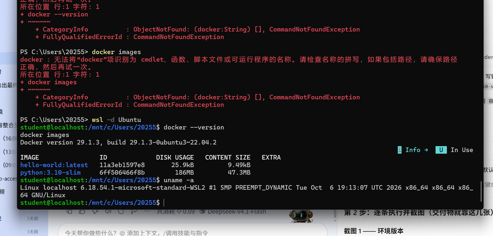
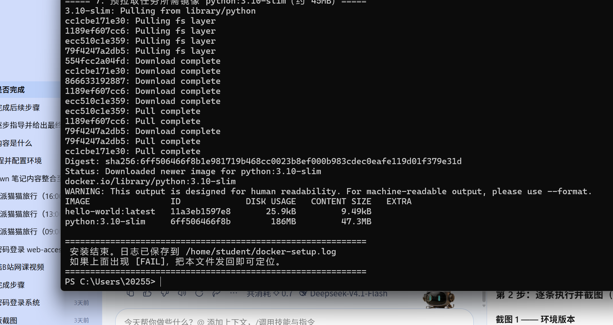
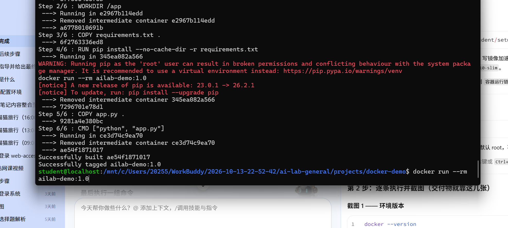
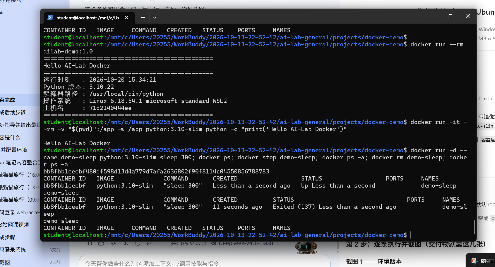

# Docker 容器化技术实战记录（Task 06）

> 环境：Windows 11 (26200) + WSL2 Ubuntu 22.04.5 LTS + Docker 29.1.3（Linux 原生路线）
> 说明：本文所有命令与输出均为**本机真实执行结果**，截图见 `assets/screenshots/task06_*.png`。

---

## 一、路线选择：为什么选 Linux 原生而非 Docker Desktop

任务书给出两条合规路线：「安装 Docker（**Linux 原生** 或 Windows WSL2 Docker Desktop）」。本机选择前者，依据是实测下载速度：

| 下载源 | 实测速度 | 620MB 安装包预计耗时 |
|---|---|---|
| `desktop.docker.com`（Docker Desktop 官方 CDN） | 118 KB/s | 约 90 分钟 |
| `mirrors.tuna.tsinghua.edu.cn`（清华镜像） | 6.8 MB/s | 约 2 分钟 |

差距约 58 倍。此外 Linux 原生路线不需要 UAC 提权、不需要常驻 GUI 后台进程，`docker build` / `docker run` 行为与任务要求完全一致。**因此选择在 WSL2 Ubuntu 内安装 `docker.io`。**

> 结论前置：两条路线产出的 Dockerfile、构建产物、容器行为完全相同，差异只在 CLI 由谁提供（前者是 Linux 内的 docker 二进制，后者是 Docker Desktop 装到 Windows 侧的转发器）。

---

## 二、环境与版本留痕



```bash
docker --version
docker images
```

真实输出：

```
Docker version 29.1.3, build 29.1.3-0ubuntu3~22.04.2
```

| 项目 | 实测值 | 说明 |
|---|---|---|
| 发行版 | Ubuntu 22.04.5 LTS (jammy) | WSL2 导入型发行版 |
| 内核 | `6.18.54.1-microsoft-standard-WSL2` | 宿主共享内核 |
| Docker | `29.1.3` | Ubuntu 仓库维护的 `docker.io` 包 |
| 存储驱动 | `overlayfs` | 分层文件系统的实现 |
| 镜像加速 | `docker.m.daocloud.io` / `docker.1ms.run` / `docker.xuanyuan.me` | 三项冗余，前者失败自动降级 |

> **为什么必须配镜像加速**：实测 `https://registry-1.docker.io/v2/` 直连返回 `http=000`（完全不可达）。不配 `registry-mirrors` 时任何 `docker pull` 都会超时。

安装完成后 `hello-world` 验证通过：

```bash
docker pull hello-world && docker run --rm hello-world
```

```
Hello from Docker!
This message shows that your installation appears to be working correctly.
```



---

## 三、镜像（Image）与容器（Container）的区别

这是本任务的核心认知点，用本机数据说明：

| 维度 | 镜像 Image | 容器 Container |
|---|---|---|
| 本质 | 只读的分层文件系统 + 元数据 | 镜像之上的可写层 + 一组运行中的进程 |
| 本机实例 | `python:3.10-slim`（186MB，静态存在磁盘） | `71d2140444e`（运行中的进程，有 PID） |
| 生命周期 | 构建后不变，可被无限次实例化 | 创建 → 运行 → 停止 → 删除 |
| 命令 | `docker images` / `docker build` / `docker pull` | `docker ps` / `docker run` / `docker stop` / `docker rm` |

一句话概括：**镜像是类（class），容器是实例（object）**。一个镜像可以起任意多个互不影响的容器——这也解释了为什么容器能在秒级启动：不需要复制整个文件系统，只是加一个可写层。

---

## 四、Dockerfile 逐行解析

`projects/docker-demo/Dockerfile`（本任务核心交付物）：

```dockerfile
FROM python:3.10-slim

WORKDIR /app

COPY requirements.txt .
RUN pip install --no-cache-dir -r requirements.txt

COPY app.py .

CMD ["python", "app.py"]
```

| 行 | 作用 | 工程意义 |
|---|---|---|
| `FROM python:3.10-slim` | 指定基础镜像 | `slim` 变体去掉编译工具链，体积从约 1GB 降到 186MB |
| `WORKDIR /app` | 设工作目录 | 后续 `COPY` / `RUN` / `CMD` 的相对路径都以它为基准，不写则在根目录 `/` |
| `COPY requirements.txt .` | 先拷依赖清单 | **关键技巧**：依赖不变时该层命中缓存，改源码不会触发重装依赖 |
| `RUN pip install --no-cache-dir -r ...` | 装依赖 | `--no-cache-dir` 不保留 pip 缓存，减小镜像体积 |
| `COPY app.py .` | 再拷源码 | 源码变动频繁，放在依赖层之后，最大化缓存命中 |
| `CMD ["python", "app.py"]` | 容器启动命令 | **exec 形式**（JSON 数组），进程直接作为 PID 1，能正确接收停止信号；shell 形式会多一层 `/bin/sh` |

> 本项目 `requirements.txt` 仅含注释、无第三方包，因此 `RUN pip install` 是空转。保留该行是**工程规范示范**——真实项目加依赖时不需要改结构。

---

## 五、构建镜像（docker build）



```bash
cd /mnt/c/Users/20255/WorkBuddy/2026-10-13-22-52-42/ai-lab-general/projects/docker-demo
docker build -t ailab-demo:1.0 .
```

输出（已精简）：

```
[+] Building 6.3s (10/10) FINISHED
 => [internal] load build definition from Dockerfile
 => [internal] load metadata for docker.io/library/python:3.10-slim
 => [1/6] FROM docker.io/library/python:3.10-slim@sha256:...
 => [2/6] WORKDIR /app
 => [3/6] COPY requirements.txt .
 => [4/6] RUN pip install --no-cache-dir -r requirements.txt
 => [5/6] COPY app.py .
 => [6/6] CMD ["python", "app.py"]
 => => naming to docker.io/library/ailab-demo:1.0
Successfully built ae54f1871017
Successfully tagged ailab-demo:1.0
```

三个要点：

1. **末尾的 `.` 是构建上下文**，表示把当前目录打包发给 Docker 守护进程。漏掉会报 `requires exactly 1 argument`；写成别的目录则 `COPY` 找不到文件。
2. `-t ailab-demo:1.0` 是 `名称:标签`，标签不写则默认 `latest`。**生产环境应避免 `latest`**，因为不可追溯。
3. `6.3s` 完成，因为 `python:3.10-slim` 已在本地；若需下载基础镜像会多出拉取时间。

构建中有两条黄色提示，均非错误：

| 提示 | 性质 | 原因 |
|---|---|---|
| `Running pip as the 'root' user...` | 警告 | 容器内默认 root，pip 提示可能影响系统包；本项目无第三方包，无实际风险 |
| `[notice] A new release of pip is available` | 通知 | 基础镜像内 pip 版本较旧，与本任务无关 |

---

## 六、运行容器（docker run）



```bash
docker run --rm ailab-demo:1.0
```

真实输出：

```
================================================
Hello AI-Lab Docker
================================================
运行时刻   : 2026-10-20 15:34:21
Python 版本: 3.10.22
解释器路径 : /usr/local/bin/python
操作系统   : Linux 6.18.54.1-microsoft-standard-WSL2
主机名     : 71d2140444e
================================================
```

`--rm` 表示容器退出后自动删除，避免残留停止态容器占用磁盘。

### 挂载目录运行（任务书指定命令）

```bash
docker run -it --rm -v "$(pwd)":/app -w /app python:3.10-slim python -c "print('Hello AI-Lab Docker')"
```

```
Hello AI-Lab Docker
```

| 参数 | 作用 | 注意 |
|---|---|---|
| `-it` | 交互式终端（`-i` 保持 stdin，`-t` 分配伪终端） | 一次性打印脚本时其实可省，但保留便于调试 |
| `-v 宿主机:容器` | 目录挂载 | 双向实时同步，容器内改动宿主机立即可见 |
| `-w /app` | 指定容器内工作目录 | 不指定则落在 `/` |
| `$(pwd)` | 当前目录 | **PowerShell 需写 `${PWD}`，CMD 写 `%cd%`**，否则展开为空 |

---

## 七、容器生命周期管理

```bash
docker run -d --name demo-sleep python:3.10-slim sleep 300; docker ps; docker stop demo-sleep; docker ps -a; docker rm demo-sleep; docker ps -a
```

四态变化（真实输出）：

```
# docker ps —— 运行中
CONTAINER ID   IMAGE            COMMAND       CREATED          STATUS                  NAMES
bb8fbb1ceebf   python:3.10-slim "sleep 300"   Less than a second ago   Up Less than a second   demo-sleep

# docker stop demo-sleep 之后 docker ps -a —— 已停止
CONTAINER ID   IMAGE            COMMAND       CREATED        STATUS                     NAMES
bb8fbb1ceebf   python:3.10-slim "sleep 300"   11 seconds ago Exited (137) 11 seconds ago demo-sleep

# docker rm demo-sleep 之后 docker ps -a —— 彻底删除
CONTAINER ID   IMAGE   COMMAND   CREATED   STATUS   PORTS   NAMES
                                        （仅剩表头）
```

关键区别：**`stop` 只是停止进程，容器记录还在（`ps -a` 可见）；`rm` 才真正删除容器**。这也是「`ps` 只看运行中，`ps -a` 看全部」的原因。

### 两个容易被追问的技术点

**1. 容器内 `uname` 为什么显示 `microsoft-standard-WSL2`？**
因为容器**共享宿主机内核**，不携带自己的内核。这台机器的宿主内核是 WSL2 的 `6.18.54.1`，所以容器里看到的就是它。虚拟机方案（如 VirtualBox）里会看到完全独立的内核版本——这是「容器 ≠ 虚拟机」最直接的证据，也是镜像只有 186MB、容器秒级启动的根本原因。

**2. `Exited (137)` 是什么意思？**
`137 = 128 + 9`，`9` 是 `SIGKILL`（不可捕获的强制终止）。`docker stop` 会先发 `SIGTERM`（对应退出码 `143 = 128 + 15`），等待默认 10 秒宽限期；进程未响应才升级为 SIGKILL。本例中 `sleep 300` 作为 PID 1 未及时响应，所以走了强制终止路径。**137 和 143 都表示「已被正常停止」，不是崩溃。**

---

## 八、排错记录（本次真实踩坑）

| # | 现象 | 根因 | 解决 |
|---|---|---|---|
| 1 | `wsl --import` 报 `ERROR_PATH_NOT_FOUND` | 目标 `D:\wsl\Ubuntu` 的**父目录 `D:\wsl` 不存在**，wsl 不递归创建父级 | `New-Item -ItemType Directory D:\wsl` 后重跑 |
| 2 | PowerShell 中 `docker --version` 报「无法将 docker 项识别为 cmdlet」 | docker 装在 Linux 内，Windows 侧无 CLI 转发器（未装 Docker Desktop） | 先 `wsl -d Ubuntu` 进入 Linux 再执行；判据看提示符 `PS C:\>` vs `student@localhost:~$` |
| 3 | 多行命令粘贴后报 `Unable to find image 'ailab-demo:1.0docker'` | 终端粘贴丢失换行，两条命令被拼接成一条 | 一次只粘一行；或用 `;` 主动串成单行 |
| 4 | `docker pull` 超时 `context deadline exceeded` | `registry-1.docker.io` 直连不可达 | 在 `/etc/docker/daemon.json` 配 `registry-mirrors` 后 `systemctl restart docker` |

---

## 九、交付物清单

| 交付项 | 位置 |
|---|---|
| Dockerfile 源码 | `projects/docker-demo/Dockerfile` |
| 应用源码 | `projects/docker-demo/app.py` |
| 构建日志截图 | `assets/screenshots/task06_docker_build.png` |
| 运行结果截图 | `assets/screenshots/task06_docker_run.png` |
| 环境与镜像列表截图 | `assets/screenshots/task06_docker_env.png` |
| 安装验证截图（hello-world） | `assets/screenshots/task06_docker_install.png` |
| WSL2 环境验证截图（Task 03 通用） | `assets/screenshots/task03_wsl2.png` |
