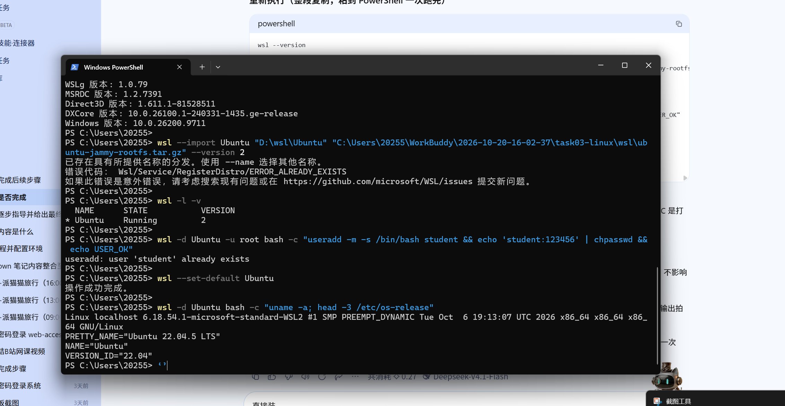

# WSL2 与 Docker 安装记录（Task 03 / Task 06）

> **状态：两项均已完成（2026-10-20 深夜）。**
> WSL2 + Ubuntu 22.04.5 完成导入；Docker 29.1.3 安装完成并验证通过。
> Docker 完整实操记录见 [`Task06-Docker实战记录.md`](./Task06-Docker实战记录.md)。
> 本文保留为**安装过程与排错依据**，便于后续重装或迁移时复现。

---

## 零、关于 `wsl.exe` 被拦（更正）

早期版本本文写过「需到 Windows 安全中心 → 命令安全 → 程序黑名单移除 `wsl.exe`」。**该结论有误，已作废。**

实测确认：注册表 `HKLM:\SOFTWARE\Policies\Microsoft\Windows\AppHVSI` 不存在，本机并无相关系统策略。
`PROGRAM BLOCKED BY SECURITY POLICY` 只出现在 AI 助手自身的执行沙箱中，**用户在普通 PowerShell 里运行 `wsl` 完全正常，不需要放行任何东西。**

---

## 一、WSL2 + Ubuntu 安装（已完成）

### 1.1 前置：启用 Windows 功能

需要**管理员** PowerShell，两条 DISM 均返回 `3010`（成功 + 需重启）：

```powershell
$env:PATH = "$env:SystemRoot\System32;$env:PATH"   # 本机 PATH 中 System32 损坏，需先修补
dism.exe /online /enable-feature /featurename:Microsoft-Windows-Subsystem-Linux /all /norestart
dism.exe /online /enable-feature /featurename:VirtualMachinePlatform /all /norestart
```

> 必须检查返回码：`0` 或 `3010` 才算成功。早期脚本漏检返回码，DISM 全部失败仍打印「开好了」，属于假成功。
> 重启后 `LxssManager` 服务才会注册。

### 1.2 离线导入发行版（实际采用路径）

比 `wsl --install -d Ubuntu-22.04` 更快：镜像已预先下载并校验 SHA256，无需联网。

```powershell
# 关键：父目录必须先存在，否则报 ERROR_PATH_NOT_FOUND
New-Item -ItemType Directory "D:\wsl" -Force

wsl --import Ubuntu "D:\wsl\Ubuntu" "C:\Users\20255\WorkBuddy\2026-10-20-16-02-37\task03-linux\wsl\ubuntu-jammy-rootfs.tar.gz" --version 2

wsl -d Ubuntu -u root bash -c "useradd -m -s /bin/bash student && echo 'student:123456' | chpasswd"
wsl --set-default Ubuntu
```

验证：

```powershell
wsl -d Ubuntu bash -c "uname -a; cat /etc/os-release | head -2"
```

```
Linux localhost 6.18.54.1-microsoft-standard-WSL2 ... x86_64 GNU/Linux
PRETTY_NAME="Ubuntu 22.04.5 LTS"
```



> 二次执行 `wsl --import` 会报 `ERROR_ALREADY_EXISTS`，说明分发已注册，属正常，忽略即可。

### 1.3 `.wslconfig` 资源限制

`%USERPROFILE%\.wslconfig`（本机 32GB 内存）：

```ini
[wsl2]
memory=8GB
processors=8
swap=2GB
localhostForwarding=true
```

---

## 二、Docker 安装（已完成）

### 2.1 路线决策

| 方案 | 实测下载速度 | 结论 |
|---|---|---|
| Docker Desktop（`desktop.docker.com`） | 118 KB/s（620MB ≈ 90 分钟） | 放弃 |
| Linux 原生（清华源 `apt install docker.io`） | 6.8 MB/s | **采用** |

任务书原文允许两条路线：「安装 Docker（**Linux 原生** 或 Windows WSL2 Docker Desktop）」。

### 2.2 实际安装步骤

```bash
# 1. 换清华 apt 源（备份原文件）
cp /etc/apt/sources.list /etc/apt/sources.list.bak
# 写入 tuna jammy 源后：
apt-get update

# 2. 安装
apt-get install -y docker.io

# 3. 配置镜像加速（不配则 pull 必然超时）
mkdir -p /etc/docker && cat > /etc/docker/daemon.json <<'EOF'
{
  "registry-mirrors": [
    "https://docker.m.daocloud.io",
    "https://docker.1ms.run",
    "https://docker.xuanyuan.me"
  ]
}
EOF

# 4. 启动（本机 systemd 可用）
systemctl enable --now docker

# 5. 普通用户免 sudo
usermod -aG docker student
```

本机实测结果：`Docker version 29.1.3`、存储驱动 `overlayfs`、`hello-world` 输出 `Hello from Docker!`。

### 2.3 可复用的一键脚本

`setup-docker.sh` 已固化为 7 步幂等脚本（换源 → 安装 → 配加速 → 启动 → 建组 → 验证 → 预拉镜像），
含环境自检、失败回退与日志落盘，可通过 `wsl -d Ubuntu -u root bash /home/student/setup-docker.sh` 重跑。
本机副本在 `/home/student/setup-docker.sh`，日志 `/home/student/docker-setup.log`。

---

## 三、常见坑速查

| 现象 | 原因 | 解决 |
|---|---|---|
| `wsl --import` 报 `ERROR_PATH_NOT_FOUND` | 安装位置的**父目录**不存在 | 先 `New-Item D:\wsl` |
| `wsl --import` 报 `ERROR_ALREADY_EXISTS` | 分发已注册 | 无需处理，直接 `wsl -l -v` 验证 |
| PowerShell 里 `docker` 报「无法识别」 | docker 在 Linux 内，Windows 无转发器 | 先 `wsl -d Ubuntu`；看提示符 `PS C:\>` / `student@localhost:~$` |
| `Cannot connect to the Docker daemon` | 守护进程未启动 | `systemctl start docker`（无 systemd 时 `service docker start`） |
| `docker pull` 卡住 / `context deadline exceeded` | Docker Hub 直连不可达（实测 `http=000`） | 配 `registry-mirrors` 后重启 docker |
| `-v $(pwd):/app` 在 PowerShell 下路径为空 | PowerShell 不解析 `$(pwd)` | 用 `${PWD}`；CMD 用 `%cd%` |
| 多行命令粘贴后拼成一条 | 终端粘贴丢失换行 | 一次粘一行，或用 `;` 串联 |
| Docker 占用 C 盘巨大 | 默认数据目录在系统盘 | WSL 原生方案数据在 `D:\wsl\Ubuntu\ext4.vhdx`，不占 C 盘 |

---

## 四、交付物对应

| 任务 | 交付物 | 存放位置 |
|---|---|---|
| Task 03 | WSL2 环境验证截图 | `assets/screenshots/task03_wsl2.png` |
| Task 03 | Linux 命令实操记录 | `docs/Linux-CLI-实战记录.md` |
| Task 06 | Dockerfile 源码 | `projects/docker-demo/Dockerfile` |
| Task 06 | 构建与运行日志截图 | `assets/screenshots/task06_docker_build.png`、`task06_docker_run.png` |
| Task 06 | 完整实战记录 | `docs/Task06-Docker实战记录.md` |
